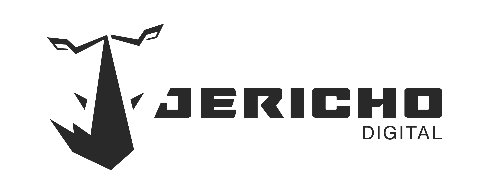

<picture>
  <source media="(prefers-color-scheme: dark)" srcset="./assets/logo.png">
  <source media="(prefers-color-scheme: light)" srcset="./assets/logo-light.png">
  
</picture>

### Code that transforms businesses.

We build custom software, SaaS products, AI integrations and agentic workflows for companies in LATAM and beyond.

[**🇺🇸 English**](#-english) · [**🇨🇴 Español**](#-español)

---

<h2 id="-english">🇺🇸 English</h2>

### About us

Jericho Digital is a Colombian software company based in Medellín. We build SaaS products, custom software, AI integrations and agentic workflows for companies across LATAM and beyond — from our own vertical products to custom platforms for partners.

Our house motto says the rest: **we don't have a big team — we have the right one.**

### Our SaaS products

| Product | What it does | Website |
|---|---|---|
| **GeroManager** | Multi-tenant platform for nursing homes — residents, staff, shifts, clinical records and medication tracking. | [geromanager.jericho-digital.com](https://geromanager.jericho-digital.com/) |
| **EngineFlow** | End-to-end SaaS for motorcycle workshops — service orders, inventory, clients, payroll and DIAN electronic invoicing. | [engineflow.jericho-digital.com](https://engineflow.jericho-digital.com/) |
| **Mulatero** | B2B marketplace connecting transport companies and drivers in Colombia — load board plus fleet management with real-time GPS. | [mulatero.jericho-digital.com](https://mulatero.jericho-digital.com/) |
| **Admika** | Residential community management — administration, residents and day-to-day operations for condos and housing complexes. | [admika.jericho-digital.com](https://admika.jericho-digital.com/) |

### Engineering

We share a disciplined, opinionated stack across every project:

Every Jericho project ships with: `strict` TypeScript, ESLint (airbnb-base) with no barrel files, Jest or Vitest at 80%+ coverage, Vite for SPAs or Next.js App Router for fullstack, hexagonal service architecture, and a standard API response shape across services.

A few of the internal tools we use every day will land here as public repos soon:

- **`architecture-standards-docs`** — our coding & architecture standards (JS/TS, React, API design, testing, security, git)
- **`jericho-scaffold-cli`** — universal project scaffolder for Node, Python, PHP, .NET and Go
- **`jericho-skill-marketplace`** — Claude Code skills that encode our team workflows

### Team

<table>
  <tr>
    <td align="center" width="25%">
      <a href="https://github.com/jorius">
        
         
        <b>Jose Ríos</b>
      </a>
       
      Co-Founder & CTO
    </td>
    <td align="center" width="25%">
      <a href="https://github.com/jlondo97">
        
         
        <b>Jhoany Londoño</b>
      </a>
       
      Co-Founder & CEO
    </td>
    <td align="center" width="25%">
      <a href="https://github.com/jlondo96">
        
         
        <b>Juan Pablo Londoño</b>
      </a>
       
      Senior FullStack Developer
    </td>
    <td align="center" width="25%">
      <a href="https://github.com/geralin">
        
         
        <b>Geralin Fernández</b>
      </a>
       
      Senior FullStack Developer
    </td>
  </tr>
</table>

### Contact

| | |
|---|---|
| **Website** | [jericho-digital.com](https://jericho-digital.com/) |
| **General inquiries** | [jericho@jericho-digital.com](mailto:jericho@jericho-digital.com) |
| **CTO — Jose Ríos** | [jriosc@jericho-digital.com](mailto:jriosc@jericho-digital.com) |
| **CEO — Jhoany Londoño** | [jlondot@jericho-digital.com](mailto:jlondot@jericho-digital.com) |
| **Location** | Medellín, Colombia · COT UTC-5 |

---

<h2 id="-español">🇨🇴 Español</h2>

### Sobre nosotros

Jericho Digital es una empresa colombiana de desarrollo de software con sede en Medellín. Construimos productos SaaS, software a medida, integraciones de IA y flujos agénticos para empresas en LATAM y más allá — desde nuestros propios productos verticales hasta plataformas a medida para aliados.

Nuestro lema interno lo resume bien: **no tenemos un equipo grande — tenemos el equipo correcto.**

### Nuestros productos SaaS

| Producto | ¿Qué hace? | Sitio |
|---|---|---|
| **GeroManager** | Plataforma multi-tenant para hogares geriátricos — residentes, personal, turnos, historias clínicas y trazabilidad de medicación. | [geromanager.jericho-digital.com](https://geromanager.jericho-digital.com/) |
| **EngineFlow** | SaaS end-to-end para talleres de motos — órdenes de servicio, inventario, clientes, nómina y facturación electrónica DIAN. | [engineflow.jericho-digital.com](https://engineflow.jericho-digital.com/) |
| **Mulatero** | Marketplace B2B que conecta transportadoras y conductores en Colombia — tablero de cargas más gestión de flota con GPS en tiempo real. | [mulatero.jericho-digital.com](https://mulatero.jericho-digital.com/) |
| **Admika** | Gestión de conjuntos residenciales — administración, residentes y operación del día a día en propiedad horizontal. | [admika.jericho-digital.com](https://admika.jericho-digital.com/) |

### Ingeniería

Compartimos un stack disciplinado y opinado en cada proyecto:

Todos nuestros proyectos incluyen: TypeScript `strict`, ESLint (airbnb-base) sin archivos barrel, Jest o Vitest con 80% o más de cobertura, Vite para SPAs o Next.js App Router para fullstack, arquitectura hexagonal por servicios y una forma estándar de respuesta de API en todos los servicios.

Varias herramientas internas que usamos todos los días se publicarán como repositorios públicos próximamente:

- **`architecture-standards-docs`** — nuestros estándares de código y arquitectura (JS/TS, React, diseño de APIs, testing, seguridad, git)
- **`jericho-scaffold-cli`** — scaffolder universal de proyectos para Node, Python, PHP, .NET y Go
- **`jericho-skill-marketplace`** — skills de Claude Code que codifican los flujos de trabajo del equipo

### Equipo

<table>
  <tr>
    <td align="center" width="25%">
      <a href="https://github.com/jorius">
        
         
        <b>Jose Ríos</b>
      </a>
       
      Co-Fundador & CTO
    </td>
    <td align="center" width="25%">
      <a href="https://github.com/jlondo97">
        
         
        <b>Jhoany Londoño</b>
      </a>
       
      Co-Fundador & CEO
    </td>
    <td align="center" width="25%">
      <a href="https://github.com/jlondo96">
        
         
        <b>Juan Pablo Londoño</b>
      </a>
       
      Desarrollador FullStack Senior
    </td>
    <td align="center" width="25%">
      <a href="https://github.com/geralin">
        
         
        <b>Geralin Fernández</b>
      </a>
       
      Desarrolladora FullStack Senior
    </td>
  </tr>
</table>

### Contacto

| | |
|---|---|
| **Sitio web** | [jericho-digital.com](https://jericho-digital.com/) |
| **Consultas generales** | [jericho@jericho-digital.com](mailto:jericho@jericho-digital.com) |
| **CTO — Jose Ríos** | [jriosc@jericho-digital.com](mailto:jriosc@jericho-digital.com) |
| **CEO — Jhoany Londoño** | [jlondot@jericho-digital.com](mailto:jlondot@jericho-digital.com) |
| **Ubicación** | Medellín, Colombia · COT UTC-5 |

---

Built with ❤️ in Medellín 🇨🇴 · © 2026 Jericho Digital S.A.S.

